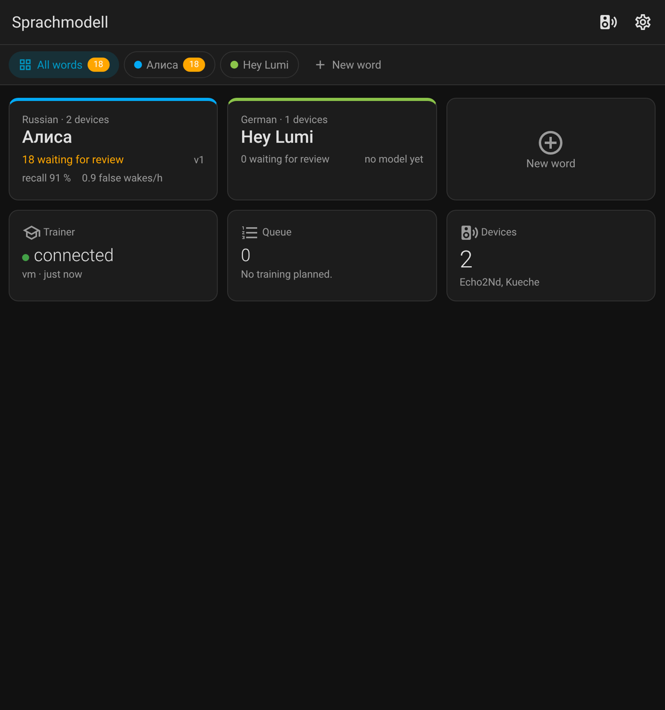
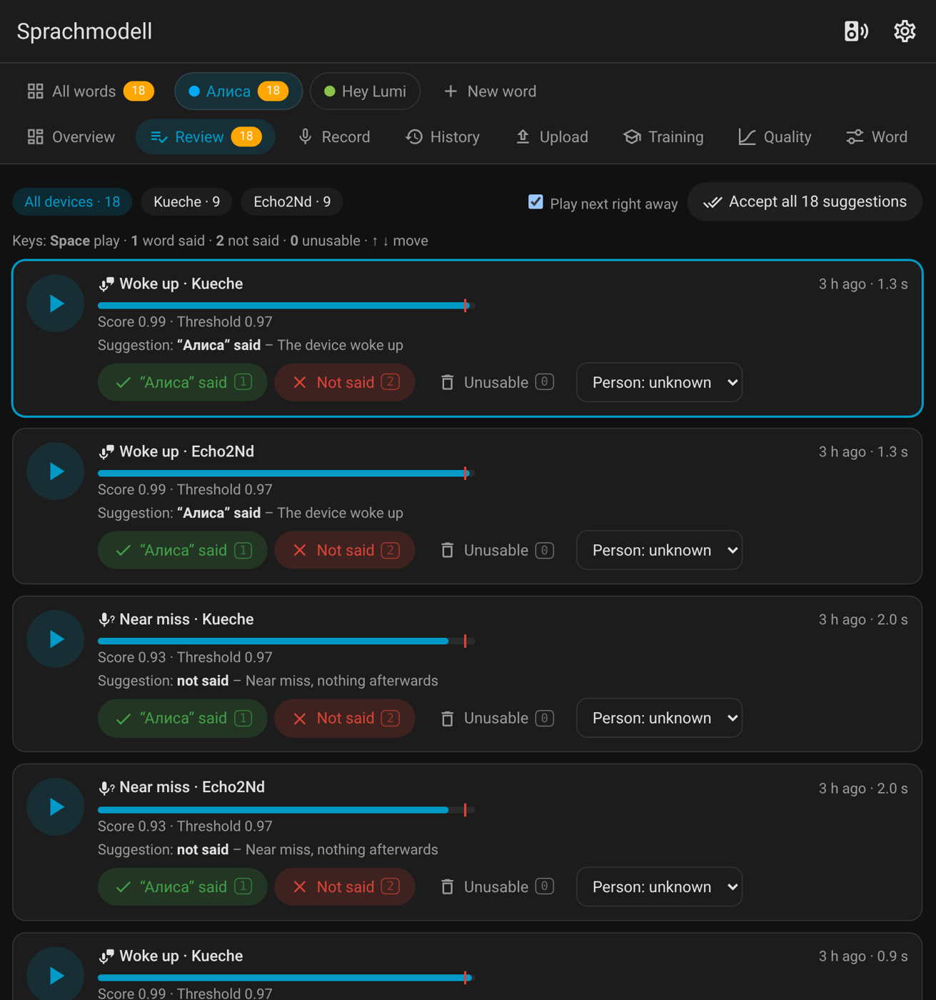
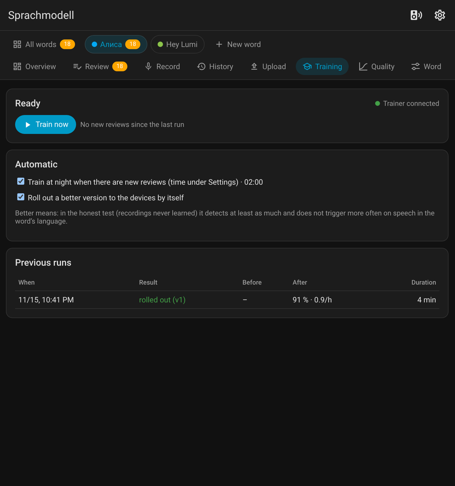
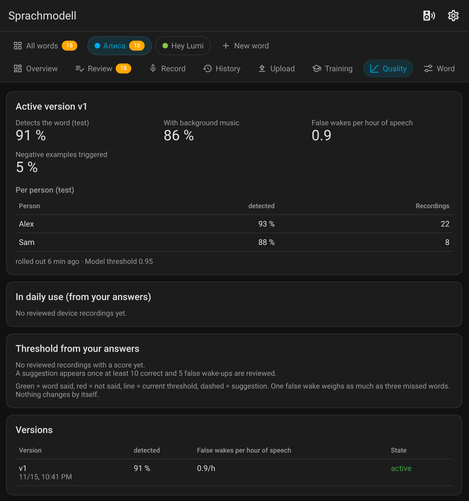
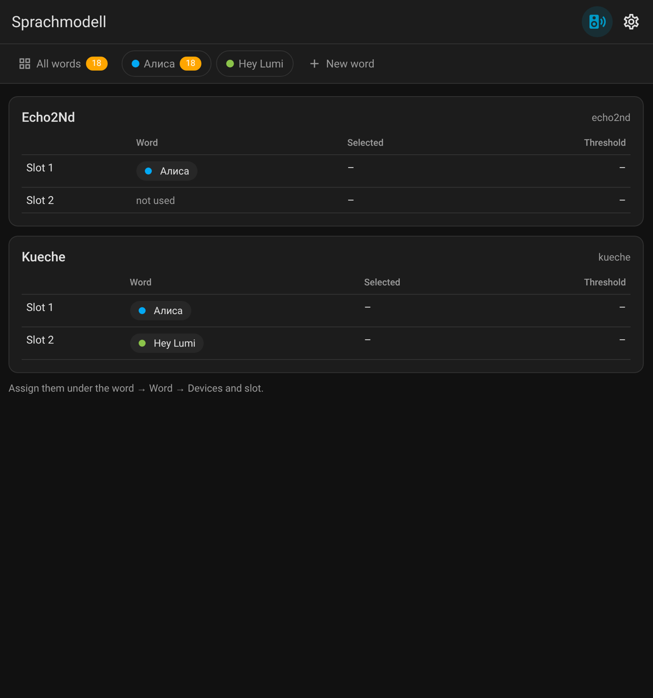
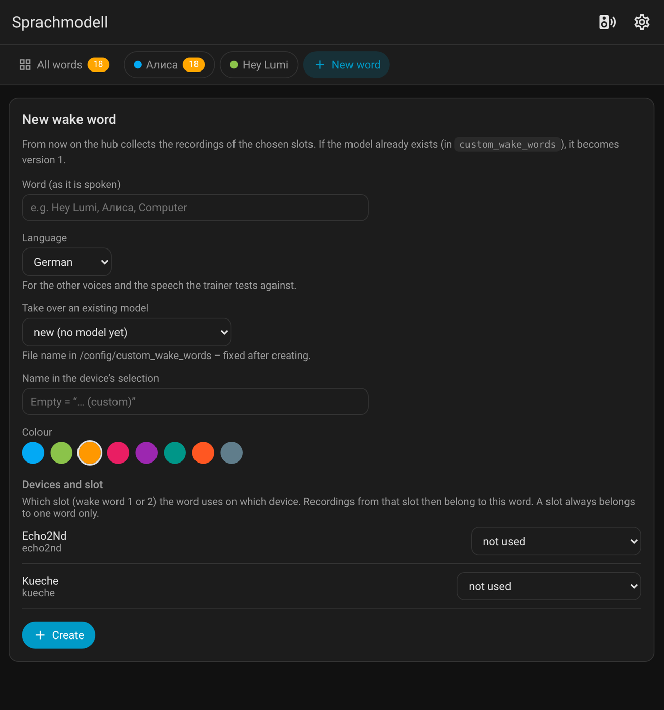
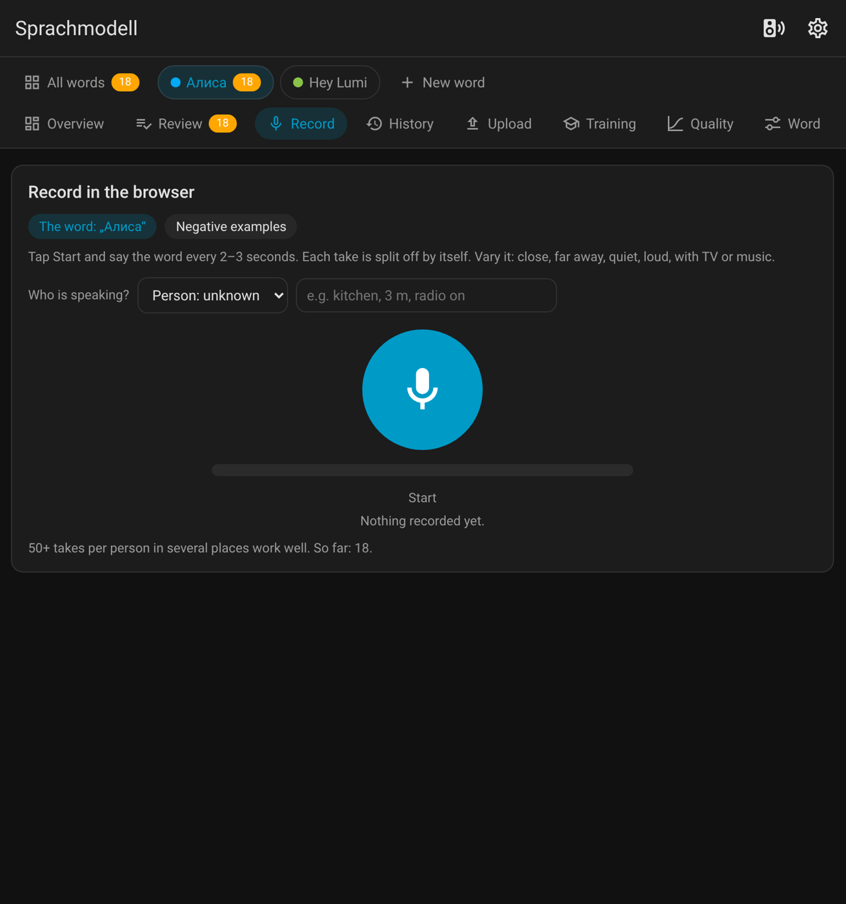

# Sprachmodell – your own wake words for Home Assistant

Create, review and improve **your own wake words** for voice satellites running
[TECHO5](https://github.com/HuskerMinion/techo5) (ESPHome, microWakeWord) – in any language, for any
number of words and devices, all inside Home Assistant. No cloud, no coding.



*[Deutsch weiter unten](#deutsch)*

## How it works

1. **Create a word** in the sidebar app (e.g. “Hey Lumi”, “Алиса”) and pick its language and the devices
   and wake word slot (1 or 2) it should run on.
2. **Collect clips.** The devices keep a few seconds of audio every time they wake up (or nearly wake up).
   You can also record the word right in the browser or upload zip files from the device's setup page.
3. **Review** with one tap or key: *word said*, *not said*, *unusable*. Each clip comes with a suggestion
   (“woke up but was cancelled”, “missed – it worked right after”).
4. **Train.** The Sprachmodell Trainer (Home Assistant app or Docker container) builds a model from your
   ratings plus thousands of synthetic voices, at night or when you press *Train now*.
5. **Honest test.** Every fifth rated clip is kept aside and never trained on. A new model is only rolled
   out if it is better on exactly these clips and does not trigger more often on everyday speech.
6. **Roll out without restart.** The model goes to the selected devices; older versions stay and can be
   rolled back with one tap.

## The app

| Page | What for |
|---|---|
| **All words** | Every word with devices, clips waiting, recall, false wakes and training state |
| **Devices** | All TECHO5 satellites found, which word runs in which slot, thresholds |
| **Overview** (per word) | Waiting clips, active version, training, devices |
| **Review** | Listen (▶ or space) and rate with **1** / **2** / **0**; accept all suggestions; choose the speaker |
| **Record** | Record the word or counter examples in the browser, cut into single takes automatically |
| **History** | Everything rated, uploaded and the test set – re-rate if you tapped wrong |
| **Upload** | Drop zip files (`word` / `not_word` folders), duplicates are detected |
| **Training** | Live progress, *Train now*, *Cancel*, train at night, auto roll-out, all runs before/after |
| **Quality** | Recall (quiet, with music, per person), false wakes per hour, threshold from your ratings, all versions |
| **Word** | Name, language, devices and slots, colour, delete |
| **Settings** | Night training time, reminders, people, cleanup, trainer connection |

<p> </p>
<p> </p>
<p> </p>

The app speaks English and German and follows the Home Assistant language.

## Install

### Integration
1. HACS → ⋮ → *Custom repositories* → `https://github.com/Wadim-dev/sprachmodell_ha`, type *Integration*,
   install **Sprachmodell** and restart Home Assistant.
   (Or copy `custom_components/sprachmodell` to `/config/custom_components/`.)
2. Settings → Devices & services → Add integration → **Sprachmodell**. Nothing to fill in.
3. On every TECHO5 device switch on **Keep wake clips**.
4. Open **Sprachmodell** in the sidebar → **New word**. You can also take over a model you already have in
   `/config/custom_wake_words/`.

### Trainer
**As a Home Assistant app** (amd64 / aarch64):
Settings → Apps → App store → ⋮ → *Repositories* → add `https://github.com/Wadim-dev/sprachmodell_ha`,
install **Sprachmodell Trainer** and start it. It connects by itself.

**As a Docker container** on a faster computer:

```bash
docker run -d --name sprachmodell-trainer --restart unless-stopped \
  -e HA_URL=http://homeassistant.local:8123 \
  -e SCHLUESSEL=<key from Sprachmodell → Settings → Trainer> \
  -v sprachmodell-trainer:/data \
  ghcr.io/wadim-dev/sprachmodell-trainer:latest
```

The first run downloads about 8 GB of base data once (negative examples, music and noise, room echo, speech
in the word's language from FLEURS, Piper voices). Details: [sprachmodell_trainer/DOCS.md](sprachmodell_trainer/DOCS.md).

## Entities

Central device **Sprachmodell**:

| Entity | Meaning |
|---|---|
| `sensor.sprachmodell_pruefliste` | clips waiting for review, all words (attribute `je_wort`) |
| `sensor.sprachmodell_trainer` | disconnected / ready / training |
| `button.sprachmodell_jetzt_holen` | fetch clips from the devices now |

One device per word (`<id>` = word id):

| Entity | Meaning |
|---|---|
| `sensor.sprachmodell_<id>_pruefliste` | clips of this word waiting |
| `sensor.sprachmodell_<id>_training` | ready, waiting, data, features, training, test, done, error (attributes `prozent`, `schritt`) |
| `sensor.sprachmodell_<id>_version` | active version |
| `sensor.sprachmodell_<id>_trefferquote` | recall in the honest test, % |
| `sensor.sprachmodell_<id>_fehlausloeser` | false wakes per hour of speech |
| `button.sprachmodell_<id>_training_starten` | start training |
| `switch.sprachmodell_<id>_nachts_trainieren` | train at night when there are new ratings |
| `switch.sprachmodell_<id>_automatisch_einspielen` | roll out better versions automatically |

If clips wait longer than 7 days (adjustable), a notification links straight to the review page.

## Trainer API (for your own trainer)

Header `X-Sprachmodell-Schluessel: <key>` (or an admin token):

| Call | Purpose |
|---|---|
| `GET /api/sprachmodell/trainer/auftrag` | job waiting? (`auftrag` with `wort_id`, `wort`, `sprache`, `aktiv`; `abbrechen`) |
| `GET /api/sprachmodell/trainer/liste?wort=<id>` | rated clips with `urteil`, `person`, `test` |
| `GET /api/sprachmodell/trainer/audio/<id>/<clip>` | WAV 16 kHz mono |
| `GET /api/sprachmodell/trainer/modell?wort=<id>` | active version (tflite) |
| `POST /api/sprachmodell/trainer/status` | `{wort_id, phase, prozent, schritt, info}` |
| `POST /api/sprachmodell/trainer/ergebnis?wort=<id>` | multipart `modell` (tflite) + `bericht` (JSON: `besser`, `cutoff`, `neu`, `alt`, `dauer_min`) |

## Credits
[microWakeWord](https://github.com/OHF-Voice/micro-wake-word) (Kevin Ahrendt, Open Home Foundation),
[Piper](https://github.com/rhasspy/piper) voices, [FLEURS](https://huggingface.co/datasets/google/fleurs),
FMA, AudioSet and MIT impulse responses for augmentation.

## License
MIT

---

# Deutsch

**Sprachmodell** ist eine Zentrale für eigene Aktivierungswörter auf Sprachsatelliten mit TECHO5: beliebig viele
Wörter, jede Sprache, Geräte und Wort-Platz (1 oder 2) frei wählbar, alles in Home Assistant.

1. **Neues Wort** in der App anlegen, Sprache und Geräte wählen (ein vorhandenes Modell aus
   `/config/custom_wake_words/` lässt sich übernehmen).
2. **Aufnahmen sammeln:** Die Geräte heben bei jedem Aufwachen ein paar Sekunden auf. Dazu kommen Aufnahmen
   im Browser (Reiter **Aufnehmen**) und Zip-Dateien (Reiter **Hochladen**).
3. **Prüfen:** mit **1** (Wort gesagt), **2** (nicht gesagt), **0** (unbrauchbar), Vorschläge auf einen Tipp übernehmen.
4. **Trainieren:** Der Trainer (HA-App oder Docker) trainiert nachts oder auf Knopfdruck aus den Bewertungen und
   tausenden künstlichen Stimmen.
5. **Ehrlich testen:** Jede fünfte Aufnahme wird nie gelernt. Eine neue Version kommt nur auf die Geräte, wenn sie
   darauf besser ist und bei Alltagsgerede nicht öfter auslöst.
6. **Einspielen ohne Neustart,** alte Versionen bleiben und lassen sich zurückholen.

Einrichten: Integration über HACS (benutzerdefiniertes Repository) installieren, **Sprachmodell** hinzufügen, an den
Geräten **Keep wake clips** einschalten. Trainer: unter Einstellungen → Apps → App-Store → ⋮ → Repositories die
Repo-Adresse eintragen und **Sprachmodell Trainer** installieren, oder den Docker-Befehl oben auf einem anderen
Rechner starten (Schlüssel aus **Sprachmodell → Einstellungen → Trainer**).
