<p align="center">
  <picture>
    <source media="(prefers-color-scheme: dark)" srcset="https://raw.githubusercontent.com/Wadim-dev/WakeWordStudio_ha/main/docs/dark_logo.png">
    
  </picture>
</p>

<h3 align="center">Your own wake word, trained at home.</h3>

<p align="center">
  Review what your voice devices heard, train a better model and roll it out – all inside Home Assistant.<br>
  Works with <b>ESPHome voice devices</b> (micro wake word) · any word, any language · no YAML, no code.
</p>

<p align="center">
  <a href="https://my.home-assistant.io/redirect/hacs_repository/?owner=Wadim-dev&repository=WakeWordStudio_ha&category=integration"></a>
</p>

<p align="center">
  <a href="https://github.com/Wadim-dev/WakeWordStudio_ha/releases"></a>
  <a href="https://github.com/Wadim-dev/WakeWordStudio_ha/actions/workflows/validate.yml"></a>
  <a href="custom_components/sprachmodell/quality_scale.yaml"></a>
  
  
  <a href="LICENSE"></a>
</p>

<p align="center">
  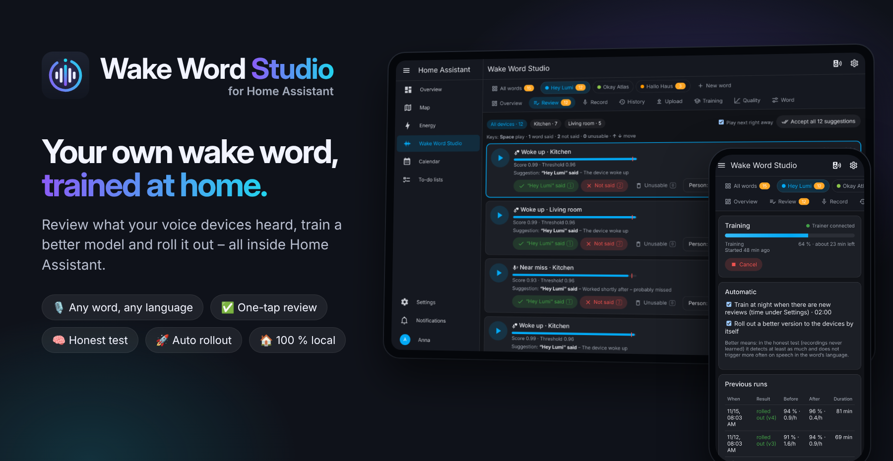
</p>

> **Made for [TECHO5](https://github.com/HuskerMinion/techo5), the Echo firmware by [HuskerMinion](https://github.com/HuskerMinion).** Wake Word Studio was built first and foremost for Echo devices running TECHO5 – HuskerMinion's open firmware that turns an Echo Show, Echo Dot, Echo Spot or Echo 2nd gen into a local Home Assistant voice device. TECHO5 keeps every wake-up and near miss and sends it straight to the Studio; the Studio trains a better wake word from it and rolls it back out to the same devices. Other ESPHome voice devices work too. TECHO5 is HuskerMinion's work and all credit for it goes there ([support it](https://buymeacoffee.com/huskerminion)).

> **Hobby project.** Wake Word Studio is free and not affiliated with Nabu Casa, ESPHome, TECHO5 or the microWakeWord project.
> Training uses the open-source [microWakeWord](https://github.com/kahrendt/microWakeWord) tools.

---

## Why Wake Word Studio?

<table>
  <tr>
    <td width="33%" valign="top"><h3>🎙️ Any word, any language</h3>"Hey Lumi", "Computer", "Алиса", "Hallo Haus" – create as many wake words as you like, in 38 languages, and decide per device which word sits on which slot.</td>
    <td width="33%" valign="top"><h3>✅ Gets better every night</h3>Your devices keep a few seconds of audio on every wake-up and near miss. You confirm with one tap, the trainer learns from your home – your voices, your rooms, your TV.</td>
    <td width="33%" valign="top"><h3>🏠 Stays at home</h3>No cloud, no account. Recordings stay in your Home Assistant; the trainer runs on your own hardware (Home Assistant app, Docker or Proxmox).</td>
  </tr>
</table>

## Get started in 3 steps

1. **Install** – tap the *Marketplace* button above, install **Wake Word Studio** and restart Home Assistant.
2. **Add the integration** – *Settings → Devices & services → Add integration → Wake Word Studio*. Confirm the storage folder (default `/share/sprachmodell`, part of your backups).
3. **Open Wake Word Studio** in the sidebar, create your word, choose the devices – done. Start a trainer from *Settings → Trainer* (one click as app, or one line for Docker/Proxmox).

---

## Built for TECHO5

<table>
  <tr>
    <td width="50%" valign="top"><h3>📣 TECHO5 on the device</h3>Your Echo runs <a href="https://github.com/HuskerMinion/techo5">TECHO5</a> (<a href="https://github.com/HuskerMinion/techo5-dot">Dot</a>, <a href="https://github.com/HuskerMinion/techo5-spot">Spot</a>, <a href="https://github.com/HuskerMinion/techo5-athena">ATHENA</a>): wake word on the device, <i>Keep wake clips</i> stores every wake-up, near miss and false wake, <i>Send wake clips to → Custom</i> sends each one to the Studio the moment it happens.</td>
    <td width="50%" valign="top"><h3>🎛️ Wake Word Studio in Home Assistant</h3>You confirm the clips with one tap, the trainer learns a better model from your home, and the new version is rolled out to the same Echos – the threshold follows by itself. The loop runs every night.</td>
  </tr>
</table>

TECHO5 is made by **[HuskerMinion](https://github.com/HuskerMinion)**, built on [EchoLocal](https://github.com/ygelfand/echolocal) by Yuri Gelfand. Without their work on the Echo hardware there would be nothing to train for – thank you! Wake Word Studio is a separate hobby project that uses what TECHO5 offers; questions about the firmware belong in the [TECHO5 repository](https://github.com/HuskerMinion/techo5).

Set-up per Echo takes a minute: *Settings → Devices that send their recordings* lists your TECHO5 devices with a button that opens each one's setup page ([details](#devices-that-send-their-recordings)).

## Supported devices

Every **ESPHome voice device** with a *Wake word* select is found by itself, whatever it is called in your home (renamed devices keep your name):
Home Assistant Voice PE, ESP32-S3-Box, M5Stack Atom Echo with micro wake word, and your own ESPHome satellites.

| Device firmware | Model rollout | Collect wake clips automatically |
|---|---|---|
| Any ESPHome voice firmware with micro wake word | ✅ | – (record in the browser or upload zips) |
| [TECHO5](https://github.com/HuskerMinion/techo5) (Echo Show, Dot, Spot, 2nd gen) | ✅ | ✅ every wake-up and near miss, sent the moment it happens |

## Review

<p align="center"></p>

Every wake-up, every "woke up, then cancelled" and every near miss shows up here with the device, its waveform, the score and a **suggestion**. Tap the waveform to play from that point; a trimmed recording plays only its trimmed part, everywhere.
Listen, then tap *said* or *not said* – or use the keyboard (**Space** play · **1** said · **2** not said · **0** unusable · **3** other word). The answer shows as a stamp on the recording, which then slides away (with a short vibration on phones). Accept all suggestions at once if you trust them.

**Other word**: with two or more words on a device, a recording of one word sometimes lands at another (someone said *Hey Lumi*, the *Kitchen* word woke up). *Other word* lets you pick the word that was really said: the recording goes there as *said*, with its trim and person, and stays here as *not said* – for this word it really was a false wake. Both words learn from it. The toast offers *Undo*, and in History the recording shows where it went, with *Undo* as well. The other model's score does not go along, so each word's statistics stay its own.

**Pre-review**: while the trainer is idle, speech recognition listens to new device recordings; each one shows what was heard, and recordings in which the word was clearly heard are confirmed by themselves (marked *auto*, filter in History, you can always change the answer). Switch: word → Training → Automatic.

**Trim**: *Trim* opens an editor like in a recording studio: a large waveform with a time ruler, handles for start and end right in the waveform (drag them, move the whole selection or draw a new one), a play head that runs along, tap to play from any point, *Automatic* finds start and end at the sound. Save, and training uses only that part. Device wake-ups are trimmed by themselves for training (word at the end, the device's sound after it cut off).

## Record and upload

<p align="center">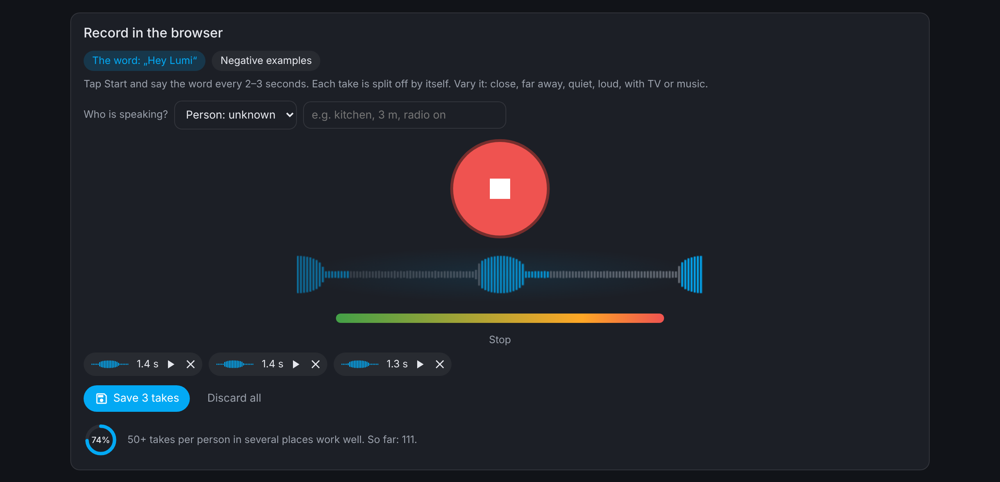</p>

Say the word into your phone or PC – every take is cut by itself. Record negative examples (similar words, normal sentences) too. Zip files with `word/` and `not_word/` folders and loose WAV files are accepted as well.

## Train and test honestly

<p align="center"></p>

At night (or on a tap) the trainer fetches the reviewed recordings, adds synthetic clips in your word's language – Piper voices plus clips from the modern voice model **OmniVoice** (men, women, children, elderly, whispering), each checked by speech recognition before it is used; your real recordings count more than the synthetic ones, and only a fixed share of synthetic clips of the word is used however large the stock grows, so they cannot make the model trigger on more things – trains a new version and tests it against recordings it **never learned** (new recordings are held back by whole days, about one day in three, so the test has days the model never heard). Similar words used as negative examples are checked by ear first: one that sounds exactly like your word is left out.
**Tested like everyday life:** every test recording is played in six conditions – quiet, soft or far away, another room (reverb), with music and noise, with a TV talking in the background, and all at once – plus a **hard test** far beyond daily life (very far away in another room, a TV or music louder than you, everything at once). Hardly any version reaches 100 % there, so two versions that both hear everything at home can still be told apart by their reserve. False wakes are counted on up to 8 hours of speech and 1 hour of music and noise. The new version and the one on your devices hear exactly the same audio in the same run.

<p align="center">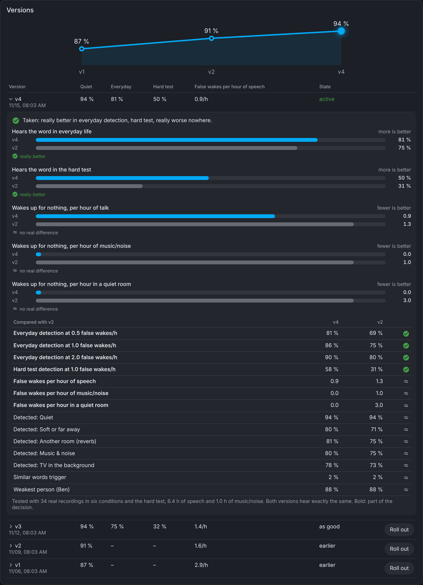</p>

**Compared honestly, not by two numbers:** the comparison looks at everyday detection at the same number of false wakes (0.5, 1 and 2 per hour – the usual way to compare wake words), the hard test at the same number of false wakes, false wakes in speech, in music/noise and in a quiet room (a threshold that wakes there does not count), every condition, similar words and the weakest person. A difference only counts when it is larger than chance for the size of your test set; otherwise both are *as good* and the version on your devices stays. The *Active version* card shows it at a glance: two bars per question (hears the word in everyday life, wakes up for nothing in talk, in music/noise) for this version and the one before, each marked *really better*, *really worse* or *no real difference*. Tap a version under *Quality → Versions* for the same view plus every figure side by side.
**Thorough** (switch under Training → Automatic): each run trains three candidates and keeps the one that hears best in everyday conditions at about one false wake per hour. Runs of the same recipe differ a lot, so the best of three is usually better than a single one. The candidates differ on purpose: the second one also learns cut-off copies of the word as negatives (someone starts the word and stops, or says a longer word that begins the same), and the third one learns from a gentle recipe (background noise always below the voice, more room sound, real noise from inside homes from CHiME-Home instead of speech as background – the way the Tater trainer prepares its clips), so the check finds out which recipe suits your word. With 20 or more real test recordings the candidates are compared on half of them and the test reports on the other half; with fewer, on check data of their own (a held-out synthetic voice, other speech and other noise than the test). Either way the honest test afterwards does not flatter the choice. **Averaged model** (switch below *Thorough*): one more model averages the three candidates. Candidates trained from different random starts make different mistakes, while your word scores high in all of them, so the average wakes less often by mistake. It needs about three times the memory on the device, so it is off by default and only used when it does better than the best single candidate; the device description gets the larger memory size by itself. It is built only from operations every supported device runs (ESPHome and TECHO5), and every model is checked for that before it leaves the trainer. A run takes about two to three times as long; the switch shows an estimate for your trainer: its processor, cores, memory and graphics card, how long a normal and a thorough run take there, and whether a night run is done by the morning.

<p align="center">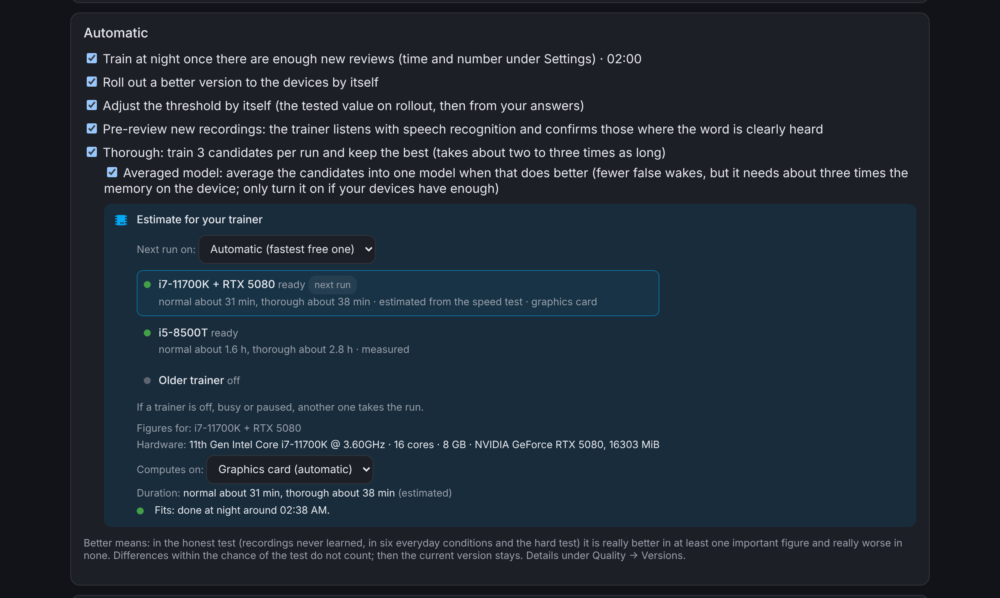</p>

Only a version that is really better somewhere important and really worse nowhere is rolled out. Home Assistant reads new wake word models when it starts, so a repair message offers the restart with one tap; afterwards the word is selected on all its devices by itself.

While it runs, the *Training* page shows the run as a path of stations (ingredients → recordings → voices → sound image → learning → testing → done), with a small scene for the step that is running and, while the model learns, a **live learning curve**: how much of the word it already hears and how often it would wake for nothing, after every check. Below that it shows every step with its start time and duration, the time left and the expected finish time, a *Running right now* card with a progress bar for everything the trainer is busy with at that moment (the step itself, each tool's own progress with count, speed and time left, OmniVoice's stock), the trainer's processor, memory and disk load, and the full live log of the run (up to 500 lines, newest first, filter *Everything / Important / Tool output*, copy with one tap; also kept after an error, so you can see what went wrong). If the trainer is held up for a long time because it waits for memory or disk, Home Assistant shows a repair message with what to do.

## Quality

<p align="center">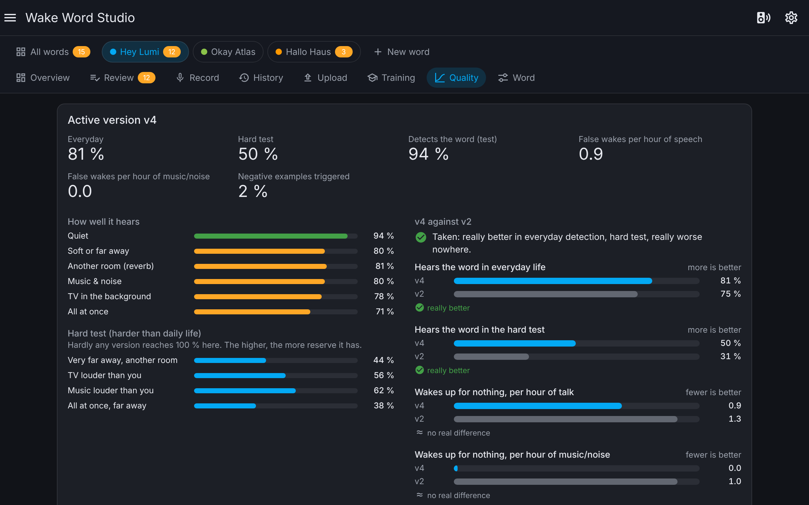</p>

Everyday detection and a bar per condition (quiet, soft, reverb, music, TV, all at once), the hard test with its four conditions, the newest measurement of the active version (every run tests it again), false wakes per hour of speech and of music/noise, results per person, a **table of your answers against the device's confidence** (cells where you and the model strongly disagree are outlined – tap one to listen to exactly those recordings and decide again), how the devices did in daily use – and the **threshold, adjusted by itself**: on rollout the devices get the value the version was tested with, afterwards it follows your answers to recordings of that version (never more than 0.03 below the tested value). Switch it off in Training → Automatic to apply the suggestion yourself. Or set **your own threshold** right there (− / + in steps of 0.01, *Set*); it then stays until you change it. Every version stays available and can be rolled back.

<p align="center">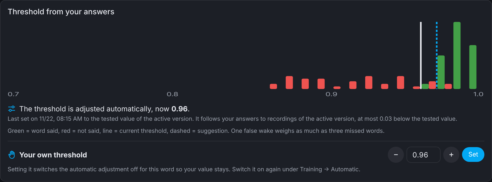</p>

**Compare any two versions:** the card *Compare versions* under *Quality* puts two versions of your choice side by side, with the same questions as the run report. Figures measured in separate runs are marked as only roughly comparable; **Fair test** has the trainer test both on exactly the same recordings, speech and noise (no training, usually 20 to 40 minutes), with the check for chance, and keeps the result.

<p align="center">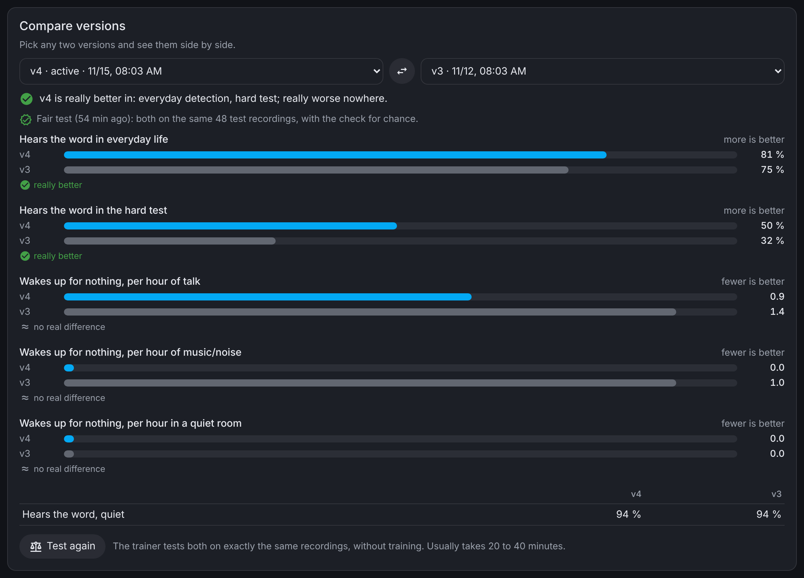</p>

## Words and devices

<p align="center">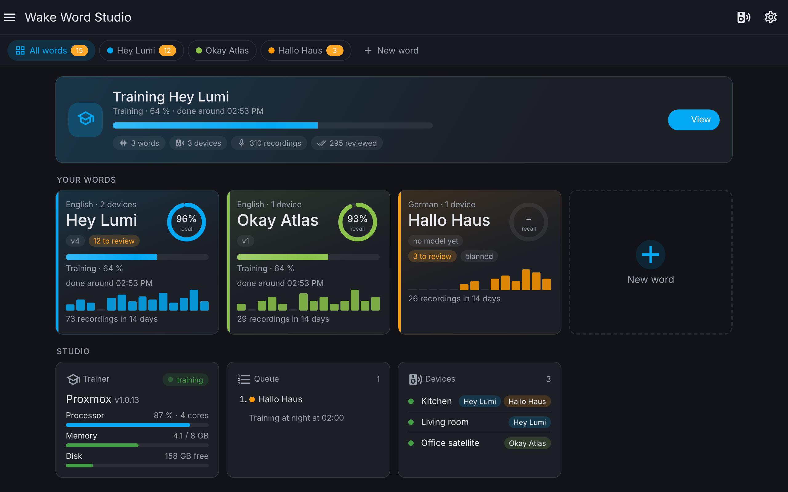</p>

The start page tells you at a glance what matters now – a training with its progress and finish time, recordings waiting for you, a missing trainer, or that all is set – with one button to the next step. Each word shows its recall, open reviews, active version and the recordings of the last 14 days; below are the trainer with its live load, the queue and every device with its words.
<p align="center">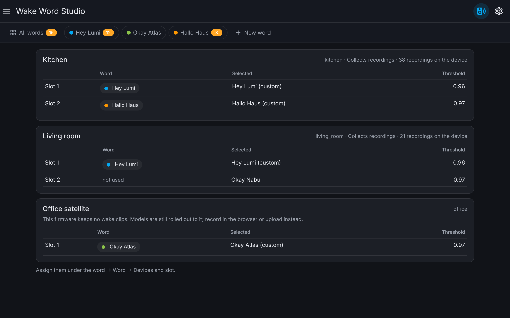</p>

## Room sound

<p align="center">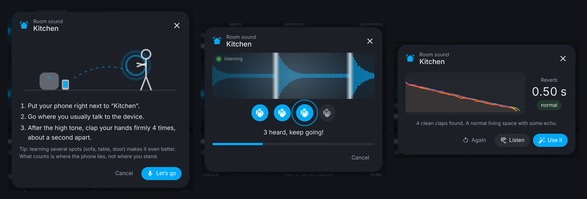</p>

A word sounds different in a tiled kitchen than on a sofa. *Devices → Learn the room* teaches the trainer how each of your rooms sounds: put your phone next to the device, go where you usually talk, and clap your hands four times after the signal tone. The studio picks out every clap with its echo, measures the reverb time (dry, normal or echoey) and lets you hear one of your own recordings of the word as the device hears it there. Learn several spots per device if you like. The trainer mixes these real room impulses into the training of the words on that device (about half of the reverb, next to the general room set); the honest test keeps the general set, so versions stay comparable. Switch: Training → Automatic → *Room sound of your devices*.

## The trainer

Training needs a lot of computing power, so it runs in its own container. It adapts to its machine (cores, memory limit and free memory decide how many workers run: less memory = slower, but it finishes). 4 GB free memory minimum, 8 GB or more is much faster; the first run downloads about 8 GB of base data once. A watchdog makes sure it never hangs: a step that stops computing or runs short of memory is stopped and run again with fewer processes or smaller batches. Interrupted downloads continue, a run lost by a trainer restart is queued again with less memory, and a finished model waits on the trainer if Home Assistant is away.

<p align="center"></p>

*Settings → Trainer* lists **your trainers**, each with a profile – version, cores, memory, swap and free disk – rated green, yellow or red with a tip what to change, a switch *Takes runs* and, for a trainer that is off, *Remove from the list*.

**Set up a trainer:** *Settings → Trainer → Set up a trainer* has a tab per place – *Home Assistant app*, *Proxmox*, *Windows PC*, *Linux / NAS* – with three short steps and one command to copy (one line, works in PowerShell, cmd and any Linux shell; the button copies it with your key).

- **Home Assistant app**: *Settings → Apps → App store → ⋮ → Repositories*, add `https://github.com/Wadim-dev/WakeWordStudio_ha`, install **Wake Word Studio Trainer** and start it. It connects by itself.
- **Proxmox VE** (own LXC container, updates itself) – in the Proxmox shell:
  ```bash
  bash -c "$(curl -fsSL https://raw.githubusercontent.com/Wadim-dev/WakeWordStudio_ha/main/sprachmodell_trainer/proxmox.sh)" -- http://homeassistant.local:8123 <key>
  ```
  A Proxmox trainer set up before 1.0.32 updates on every restart; to let it update while running too, paste the line its profile shows once (`… proxmox.sh)" -- update`, container and data stay). The container is placed on a local disk of the Proxmox host (the one with most free space, never network storage such as a NAS – training reads its data all the time). `CT_STORAGE=<name>` chooses one. If an existing trainer container lives on network storage: stop it, then *Resources → Root Disk → Volume Action → Move Volume* to a local storage.
- **Windows PC** (Docker Desktop) or **Linux / NAS** (Docker), one line:
  ```bash
  docker run -d --name wake-word-studio-trainer --restart unless-stopped -v wake-word-studio-trainer:/data -v /var/run/docker.sock:/var/run/docker.sock -e HA_URL=http://homeassistant.local:8123 -e KEY=<key> ghcr.io/wadim-dev/wake-word-studio-trainer:latest
  ```
- **With an NVIDIA graphics card** (Windows with Docker Desktop, or Linux with the NVIDIA Container Toolkit): the same with `--gpus all` and the `:gpu` image.
  ```bash
  docker run -d --name wake-word-studio-trainer --restart unless-stopped --gpus all -v wake-word-studio-trainer:/data -v /var/run/docker.sock:/var/run/docker.sock -e HA_URL=http://homeassistant.local:8123 -e KEY=<key> ghcr.io/wadim-dev/wake-word-studio-trainer:gpu
  ```

The key is shown to administrators under *Wake Word Studio → Settings → Trainer*.

**Updates by itself:** a Docker trainer started with `-v /var/run/docker.sock:/var/run/docker.sock` (as in the commands above) updates itself. When Home Assistant has a newer version and its trainer image is published, the trainer fetches it while it is idle and swaps its container for a new one with the same settings (name, data, graphics card, key). If the new one does not keep running, the old one is started again. No command is needed after the first one. Without that part, a restart fetches the new version.

**Several trainers:** you can run more than one, for example the Proxmox container as the main trainer and a PC with a graphics card that is only on now and then. All of them train from the same recordings and data in Home Assistant, so it does not matter which one runs a word. *Training → Automatic → Next run on* chooses *Automatic (fastest free one)* or one fixed trainer; if that one is off or does not take runs, the others take over. Each trainer shows its status and how long a run would take on it: *measured* from its own last run, otherwise *estimated* from a short speed test every trainer runs at start, compared with a trainer that has already trained. A restart of one trainer only affects the run on that trainer, which then starts again.

**Restart from the studio:** in each trainer's profile under *Settings → Trainer* choose once the Home Assistant button that restarts it (for example the Proxmox, Portainer or app button). *Restart trainer* then restarts it from there, shows *Restarting …* until the trainer reports back with the new version, and on restart it fetches the newest version. If a training is running, it asks first; the trainer continues the run afterwards. After an update the start page shows what is still to do (install the new version, restart Home Assistant, restart a trainer) with the button right there.

**Graphics card (NVIDIA):** at start the `:gpu` trainer tries the card once. If it works, training runs on it; if not, the processor does the work, so the `:gpu` image never does worse than the normal one. *Training → Automatic* shows the result with the reason (no card passed in, or a card the training program cannot use), and with a working card a choice *Graphics card (automatic) / Processor only*. Each run in the list says where it ran, durations are estimated per device, and if the card fails during a run, the processor finishes it. Tested with an RTX 5080 (Blackwell) and TensorFlow 2.21: it trains on the card. RTX 20 to RTX 50 cards are expected to work; if the Training page says the card cannot be used, please report it. Making the voices (Piper, OmniVoice) and speech recognition stay on the processor. The Home Assistant app and the Proxmox container always use the processor; for the card run the Docker command above on the computer that has it. Docker Desktop on Windows gives containers only half of the PC's memory; more memory makes training faster: put `[wsl2]` and for example `memory=12GB` (two lines, about three quarters of the PC's memory) into the file `%UserProfile%\.wslconfig`, then run `wsl --shutdown` and start Docker Desktop again.

**Version check:** the trainer has its own version and only changes when the trainer itself changes, so many updates of the integration need no trainer update at all. If a Docker or Proxmox trainer is older than the trainer version the integration needs, the trainer profile also says whether the new trainer image is already published (it is built about 30 minutes after a release); a restart before that still fetches the old version.

Without a graphics card OmniVoice is slow, so its clips are built up over several runs (at most 90 minutes per run, `OMNI_MIN=<minutes>` changes it, `0` switches it off). Speech recognition uses faster-whisper `small` (`WHISPER_MODELL=` changes it). Both models are downloaded on first use (about 3.5 GB) and run only on the trainer. The OmniVoice model is licensed CC BY-NC (non-commercial): it is used only to create training audio on your own trainer.

### Devices that send their recordings

<p align="center">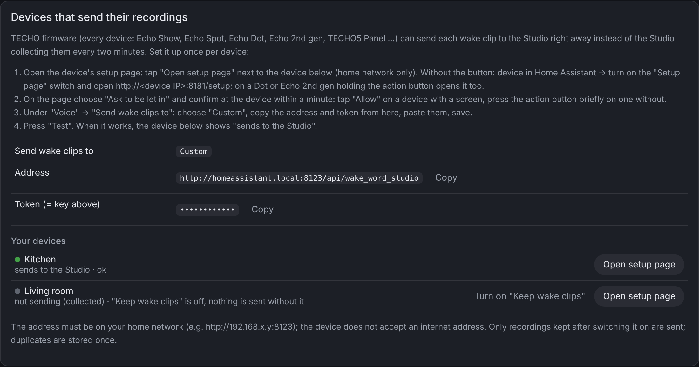</p>

Every TECHO device (Echo Show, Echo Spot, Echo Dot, Echo 2nd gen, TECHO5 Panel …, firmware 1.6.43 or newer) can send each wake clip to the Studio the moment it is kept, instead of the Studio collecting it every two minutes. Set it up once per device – *Settings → Devices that send their recordings* walks you through it:

1. Tap **Set up** next to the device (home network only). The Studio turns on *Keep wake clips* and the setup page and opens it.
2. On the page choose **Ask to be let in** and confirm at the device: tap *Allow* on a device with a screen, press the action button briefly on one without.
3. Under **Voice → Send wake clips to** choose **Custom**, paste the address `http://<home assistant>:8123/api/wake_word_studio` and the token (the trainer key) with the copy buttons, save.
4. Press **Test**. The device list then shows *sends to the Studio*, with clips still waiting and the last problem, if any.

Each device in the list has its own switches for *Keep wake clips* and the setup page and a *Send to* menu, all set from Home Assistant, so you don't have to look for them in the device's settings. Only the address and the token can't be set from Home Assistant (the firmware allows that on its own page only), and a browser on the home network is let in at the device. Turning *Keep wake clips* off asks first, because the device then deletes its clips. Other firmware can use the same receiver:

| | |
|---|---|
| URL | `http://<home assistant>:8123/api/wake_word_studio/api/clips` (test: `GET …/api/clips/ping`; the older `…/api/sprachmodell/api/clips` and `…/api/sprachmodell/clips` keep working) |
| Header | `Authorization: Bearer <trainer key>` |
| Body | multipart: `audio` (16 kHz mono WAV, up to 2 MB) and `meta` (JSON: `name`, `device`, `kind`, `at`, `model`, `slot`, `score`, `cutoff`) |

The word is found by the device and slot (or the model name). The same audio is stored only once, even if the device is asked for its clips later.

---

## Configuration

| Where | What |
|---|---|
| Setup / *Reconfigure* | **Storage folder** for recordings, versions and settings. Changing it moves all data to the new folder (copied first, the old folder is deleted only when the copy is complete). A folder that already holds Wake Word Studio data is used as it is. |
| Panel → Settings | Training time at night, how many newly reviewed recordings a night run needs (default 20), reminder after how many days, how long unreviewed recordings are kept, list of people. |
| Panel → word → Word | Word, language, name in the device selection, colour, devices and slot. |
| Panel → word → Training | Train at night, roll out a better version by itself, adjust the threshold, pre-review new recordings. |

Creating words, assigning devices, rolling out, changing settings and deleting are for **administrators**. Everybody else can review, record and upload.

## Entities

| Entity | Meaning |
|---|---|
| `sensor.<hub>_review_queue` | Recordings of all words waiting for review (attribute: per word) |
| `sensor.<hub>_trainer` | `disconnected`, `ready`, `training` (diagnostic) |
| `button.<hub>_fetch_recordings_now` | Ask the devices right away |
| `sensor.<word>_review_queue` | Waiting recordings of this word (per device, oldest) |
| `sensor.<word>_training` | `ready`, `waiting`, `preparing`, `fetching_data`, `features`, `training`, `testing`, `done`, `error` with progress and minutes left |
| `sensor.<word>_recall`, `sensor.<word>_false_wakes` | Result of the honest test of the active version |
| `sensor.<word>_active_version` | Active model version (diagnostic, disabled by default) |
| `button.<word>_start_training` | Queue a training run |
| `switch.<word>_train_at_night`, `switch.<word>_roll_out_better_version`, `switch.<word>_adjust_threshold_automatically`, `switch.<word>_pre_review_new_recordings` | Automatic behaviour (configuration) |

Each word is its own device; it is created and removed together with the word.

### Example: remind me on my phone

```yaml
triggers:
  - trigger: numeric_state
    entity_id: sensor.wake_word_studio_review_queue
    above: 20
actions:
  - action: notify.mobile_app_my_phone
    data:
      message: "{{ states('sensor.wake_word_studio_review_queue') }} wake word recordings are waiting."
      data:
        url: /wake-word-studio/pruefen
```

## How data is updated

No entity polls. Devices with wake clips are asked every two minutes and right away when their *Wake clips* counter changes; already known clips are never fetched again and nothing is changed on the device. The trainer asks Home Assistant every 20 seconds for a job and reports progress while it works.

## Use cases

- A wake word nobody else has – the name of your house, your assistant or a word in your language.
- Fewer false wakes from the TV: review the mistakes for a week, let it train at night, done.
- Family members with different voices: record each person, see the recall per person.

## Known limitations

- Training needs a 64-bit machine (amd64 or aarch64); a Raspberry Pi 4 works but is slow.
- Automatic collection needs firmware that keeps wake clips; other devices still receive the models.
- Two wake word slots per device at most (as ESPHome offers).

## Troubleshooting

| Problem | Solution |
|---|---|
| Device missing | It needs a *Wake word* select in ESPHome. Devices without wake clips are listed too, with a note. |
| *Device not found* repair | The device was renamed, replaced or is offline. Choose it again under the word → Word → Devices and slot. |
| *No trainer connected* repair | Start the trainer app or container; check the key under Settings → Trainer. |
| Training stopped with *trainer did not report back* | The trainer restarted (update, out of memory). It adapts to memory by itself; start the run again. |
| New version not on the device | Restart Home Assistant (repair message *New wake word version ready*); the word is then selected by itself. You can also use *Select on the devices* on the word page. |
| *Trainer is slowed down* repair | The trainer mostly waits for memory or disk. Give its container more memory or move its disk to a local SSD (see *Settings → Trainer → Profile*). |

Diagnostics (*Settings → Devices & services → Wake Word Studio → ⋮ → Download diagnostics*) never contain the trainer key or names of people.

## Ideas, questions and bugs

- 💡 **Ideas and suggestions**: post them in [Discussions → Ideas](https://github.com/Wadim-dev/WakeWordStudio_ha/discussions/categories/ideas). Others can vote with 👍; good ideas become issues.
- ❓ **Questions and your setup**: [Discussions](https://github.com/Wadim-dev/WakeWordStudio_ha/discussions).
- 🐞 **Something broken**: [open an issue](https://github.com/Wadim-dev/WakeWordStudio_ha/issues/new/choose); the form asks for versions and the log.

## Removal

1. *Settings → Devices & services → Wake Word Studio → ⋮ → Delete*.
2. Remove the trainer (app, Docker container or Proxmox container).
3. Optional: delete the storage folder and the model files in `/config/custom_wake_words` if you no longer use them.
4. Uninstall Wake Word Studio in the Marketplace.

---

## Deutsch

**Gebaut für [TECHO5](https://github.com/HuskerMinion/techo5), die Echo-Firmware von [HuskerMinion](https://github.com/HuskerMinion):** Wake Word Studio ist vor allem für Echo-Geräte mit HuskerMinions offener Firmware TECHO5 entstanden (aufgebaut auf [EchoLocal](https://github.com/ygelfand/echolocal) von Yuri Gelfand; danke für die Arbeit!) (Echo Show, [Dot](https://github.com/HuskerMinion/techo5-dot), [Spot](https://github.com/HuskerMinion/techo5-spot), Echo 2. Gen.). TECHO5 hebt jede Aktivierung und jeden Beinahe-Treffer auf und schickt sie sofort ans Studio, das Studio trainiert daraus ein besseres Aktivierungswort und spielt es wieder auf dieselben Echos. Andere ESPHome-Sprachgeräte gehen auch.

**Wake Word Studio** macht aus Home Assistant eine Werkstatt für eigene Aktivierungswörter: beliebig viele Wörter in jeder Sprache, Geräte und Platz frei wählbar, Aufnahmen mit einem Tipp prüfen, im Browser aufnehmen oder Zips hochladen, nachts trainieren, ehrlich testen und nur bessere Versionen von selbst einspielen. Die ganze Oberfläche gibt es auf Deutsch.

1. Über den Marketplace installieren und Home Assistant neu starten.
2. *Einstellungen → Geräte & Dienste → Integration hinzufügen → Wake Word Studio*, Ablageordner bestätigen (später änderbar über *Neu konfigurieren*, die Daten ziehen mit um).
3. **Wake Word Studio** in der Seitenleiste öffnen, Wort anlegen, Geräte wählen, Trainer starten (App, Proxmox, Windows-PC oder Linux – *Einstellungen → Trainer → Trainer einrichten* zeigt die Schritte und einen Befehl zum Kopieren).

**Getestet wie im Alltag, ehrlich verglichen:** Jede Testaufnahme läuft in sechs Lagen (ruhig, leise oder weit weg, anderer Raum mit Hall, mit Musik und Geräuschen, mit Fernseher im Hintergrund, alles zusammen) und zusätzlich im **Härtetest**, der viel schwerer ist als der Alltag (sehr weit weg im anderen Raum, Fernseher oder Musik lauter als du, alles zusammen). Dort erreicht kaum eine Version 100 %, so lassen sich zwei Versionen auch dann unterscheiden, wenn beide im Alltag alles hören; Fehlauslöser werden auf bis zu 8 Stunden Gerede und 1 Stunde Musik und Geräusche gezählt; neue und aktive Version hören im selben Lauf genau dasselbe. Verglichen wird nicht an zwei Zahlen, sondern an der Erkennung im Alltag bei gleich vielen Fehlauslösern (0,5, 1 und 2 pro Stunde), dem Härtetest bei gleich vielen Fehlauslösern, den Fehlauslösern in Gerede, Geräuschen und im stillen Raum (eine Schwelle, die dort anspringt, zählt nicht), jeder Lage, ähnlichen Wörtern und der schwächsten Person. Ein Unterschied zählt nur, wenn er größer ist als der Zufall bei deiner Menge an Testaufnahmen; sonst sind beide *gleich gut* und die aktive Version bleibt. Die Karte *Aktive Version* zeigt das auf einen Blick: zwei Balken je Frage (hört das Wort im Alltag, springt grundlos an bei Gespräch, bei Musik/Geräuschen) für diese und die Version davor, jeweils mit *wirklich besser*, *wirklich schlechter* oder *kein echter Unterschied*. Ein Tipp auf eine Version unter *Qualität → Versionen* zeigt dasselbe und alle Werte nebeneinander.

Die Seite *Qualität* zeigt außerdem eine Tabelle aus deinen Antworten und der Sicherheit des Geräts; auffällige Zellen (du und das Modell seid euch sehr uneinig) sind orange umrandet, ein Tipp öffnet genau diese Aufnahmen zum Nachhören.

Die Startseite zeigt oben, was gerade zählt (Training mit „fertig ca. HH:MM“, wartende Aufnahmen, Trainer fehlt, neue Version bereit), mit einem Knopf zum nächsten Schritt; darunter jedes Wort mit Erkennungsquote und den Aufnahmen der letzten 14 Tage, den Trainer mit Auslastung, die Warteschlange und die Geräte.

Die Seite *Training* zeigt während eines Laufs den Weg als Stationen (Zutaten → Aufnahmen → Stimmen → Klangbild → Lernen → Prüfen → Fertig) mit einer kleinen Szene zum laufenden Schritt und beim Lernen eine **Live-Lernkurve**: wie viel vom Wort das Modell schon hört und wie oft es grundlos auslösen würde, nach jeder Prüfung. Darunter jeden Schritt mit Startzeit und Dauer, Restzeit und voraussichtliches Ende, eine Karte *Gerade aktiv* mit einem Ladebalken für alles, woran der Trainer gerade arbeitet (der Schritt selbst, der eigene Fortschritt jedes Werkzeugs mit Anzahl, Tempo und Restzeit, der Vorrat von OmniVoice), die Auslastung des Trainers (Prozessor, Arbeitsspeicher, Platte) und das ganze Live-Protokoll des Laufs (bis 500 Zeilen, neueste oben, Filter *Alles / Wichtig / Ausgabe der Werkzeuge*, mit einem Tipp kopierbar), das auch nach einem Fehler stehen bleibt. Eine bessere Version liegt danach bereit; Home Assistant liest neue Modelle beim Start, deshalb bietet eine Reparaturmeldung den Neustart mit einem Tipp an, danach wird das Wort an den Geräten von selbst ausgewählt.

Für das Training kommen künstliche Aufnahmen dazu (Piper und das moderne Stimmenmodell OmniVoice: Männer, Frauen, Kinder, Ältere, Flüstern), jede vorher per Spracherkennung geprüft. Deine echten Aufnahmen zählen mehr als die künstlichen, und vom Wort selbst wird nur ein fester Anteil künstlicher Aufnahmen genutzt, egal wie groß der Bestand wird. Nachts wird erst trainiert, wenn genug Aufnahmen neu bewertet sind (Standard 20, unter *Einstellungen*). Ähnliche Wörter, die genau wie dein Wort klingen, fliegen raus. Neue Aufnahmen werden tageweise für den Test zurückgehalten. *Gründlich* (Schalter unter Training → Automatik): Pro Lauf werden drei Kandidaten trainiert, der beste bleibt. Der zweite lernt zusätzlich abgebrochene Wörter als Gegenbeispiele, der dritte lernt mit einem sanften Rezept (Störgeräusch immer leiser als die Stimme, mehr Raumhall, echte Geräusche aus Wohnungen von CHiME-Home statt Gerede als Hintergrund – so bereitet der Tater-Trainer seine Aufnahmen auf). So zeigt sich, welches Rezept zu deinem Wort passt. Ab 20 echten Testaufnahmen wird auf der einen Hälfte gewählt und der Test zeigt die andere Hälfte, sonst wird auf eigenen Prüfdaten gewählt, nie auf dem Test. *Gemitteltes Modell* (Schalter darunter): Ein weiteres Modell mittelt die drei Kandidaten; das löst seltener grundlos aus, braucht aber etwa dreimal so viel Speicher auf dem Gerät. Deshalb ist es anfangs aus und wird nur genutzt, wenn es besser abschneidet als der beste einzelne Kandidat. Es besteht nur aus Rechenschritten, die alle unterstützten Geräte können (ESPHome und TECHO5); jedes Modell wird vor dem Versand darauf geprüft. Ein Lauf dauert etwa zwei- bis dreimal so lange; darunter steht eine Einschätzung für deinen Trainer (Prozessor, Kerne, Speicher, Grafikkarte, Dauer, ob ein Nachtlauf bis morgens fertig ist). *Vorprüfen* (Schalter unter Training → Automatik): Der Trainer hört neue Aufnahmen ab, zeigt was er verstanden hat und bestätigt eindeutige von selbst (Markierung *automatisch*, jederzeit änderbar). *Zuschneiden* öffnet einen Editor wie im Tonstudio: große Wellenform mit Zeitleiste, Griffe für Anfang und Ende direkt in der Wellenform, mitlaufender Abspielstrich, Antippen spielt ab der Stelle, *Automatisch* findet Anfang und Ende am Ton; nur dieser Teil wird trainiert und beim Anhören gespielt. *Anderes Wort* (Taste **3**, nur bei mehreren Wörtern): Hat jemand ein anderes deiner Wörter gesagt, wählst du das richtige Wort; die Aufnahme zählt dort als Treffer (mit Zuschnitt und Person) und hier als „nicht gesagt“, beide Wörter lernen daraus, *Rückgängig* geht jederzeit. Jede Aufnahme zeigt ihre Wellenform; eine Bewertung erscheint als Stempel, dann gleitet die Aufnahme weg. Geräte, die ihre Aufnahmen selbst senden können, schicken sie direkt: unter *Einstellungen* hat jedes Gerät Schalter für *Aufnahmen behalten* und die Einrichtungsseite, ein Menü *Senden an* und den Knopf *Einrichten*; einmal am TECHO auf der Einrichtungsseite unter Voice → *Send wake clips to* → **Custom**, Adresse `http://<home assistant>:8123/api/wake_word_studio`, Token = Schlüssel des Trainers (steht unter *Einstellungen → Geräte, die Aufnahmen selbst senden*).

**Raumklang je Gerät:** Unter *Geräte → Raum anlernen* legst du dein Handy neben das Gerät, gehst an deinen üblichen Platz und klatschst nach dem Signalton viermal. Das Studio löst jeden Klatscher mit seinem Echo heraus, misst den Nachhall (trocken, normal oder hallig) und spielt dir eine deiner Aufnahmen so vor, wie das Gerät sie in diesem Raum hört. Der Trainer mischt diese echten Raum-Impulse ins Training der Wörter auf diesem Gerät (etwa die Hälfte des Halls, neben den allgemeinen Räumen); der ehrliche Test bleibt bei den allgemeinen Räumen, damit Versionen vergleichbar bleiben. Schalter: Training → Automatisch → *Raumklang deiner Geräte*. Unter *Qualität* lässt sich die Schwelle auch **von Hand** setzen (− / + in 0,01-Schritten, *Setzen*); sie bleibt dann, bis du sie änderst. Darunter vergleicht *Versionen vergleichen* zwei beliebige Versionen; Werte aus getrennten Läufen sind als grob markiert, *Fair testen* lässt den Trainer beide auf genau denselben Aufnahmen prüfen (ohne Training, meist 20 bis 40 Minuten).

Den Trainer startest du aus dem Studio neu: Im Steckbrief jedes Trainers unter *Einstellungen → Trainer* einmal die Taste aus Home Assistant wählen, die ihn neu startet (z. B. von Proxmox, Portainer oder der App), dann genügt *Trainer neu starten*. Bis er sich mit der neuen Version zurückmeldet, steht dort *Startet neu …*. Der Trainer hat eine eigene Version und ändert sich nur, wenn sich am Trainer etwas ändert; viele Updates brauchen also keinen neuen Trainer. Beim Neustart holt er sich die neueste Version. Nach einem Update zeigt die Startseite, was noch zu tun ist (neue Version installieren, Home Assistant oder einen Trainer neu starten), mit dem Knopf direkt daneben. Ein Docker-Trainer, der mit `-v /var/run/docker.sock:/var/run/docker.sock` gestartet wurde (steht so im Befehl zum Kopieren), aktualisiert sich selbst: Er holt die neue Version, wenn er nichts zu tun hat, und tauscht seinen Container gegen einen neuen mit denselben Einstellungen; startet der neue nicht, läuft der alte weiter. Ist das neue Trainer-Paket nach einem Update noch nicht fertig gebaut (etwa 30 Minuten), steht das im Steckbrief.

**Mehrere Trainer:** Es können mehrere laufen, z. B. der Proxmox-Container als Haupttrainer und ein PC mit Grafikkarte, der nur ab und zu an ist. Alle trainieren aus denselben Aufnahmen und Daten in Home Assistant. Unter *Training → Automatik → Nächster Lauf auf* wählst du *Automatisch (schnellster freier)* oder einen festen Trainer; ist er aus oder nimmt keine Läufe an, übernehmen die anderen. Jeder Trainer zeigt seinen Zustand und wie lange ein Lauf bei ihm dauert: *gemessen* aus seinem letzten Lauf, sonst *geschätzt* aus einem kurzen Tempotest beim Start. Unter *Einstellungen → Trainer* stehen alle Trainer mit Steckbrief, dem Schalter *Nimmt Läufe an* und *Aus der Liste entfernen* für einen, der aus ist.

**Grafikkarte (NVIDIA):** Mit dem Docker-Bild `:gpu` und `--gpus all` testet der Trainer die Karte beim Start und trainiert darauf, sonst automatisch auf dem Prozessor. Die Training-Seite zeigt das Ergebnis mit Grund und, wenn die Karte geht, die Wahl *Grafikkarte (automatisch) / Nur Prozessor*; jeder Lauf zeigt, worauf er lief. Getestet mit einer RTX 5080 und TensorFlow 2.21: Sie trainiert auf der Karte; erwartet wird, dass RTX 20 bis RTX 50 gehen. Die HA-App und der Proxmox-Container rechnen immer auf dem Prozessor. Docker Desktop unter Windows gibt Containern nur die Hälfte des Arbeitsspeichers; mehr Speicher macht das Training schneller: `[wsl2]` und zum Beispiel `memory=12GB` (zwei Zeilen, etwa drei Viertel des Arbeitsspeichers im PC) in die Datei `%UserProfile%\.wslconfig` schreiben, dann `wsl --shutdown` ausführen und Docker Desktop neu starten.

Gefunden wird jedes ESPHome-Sprachgerät mit der Auswahl „Aktivierungswort“, egal wie es heißt. Geräte mit Firmware, die Aufnahmen aufhebt (z. B. TECHO, Schalter *Keep wake clips*), liefern ihre Aufnahmen von selbst.

**Ideen, Fragen, Fehler:** Ideen und Vorschläge unter [Discussions → Ideas](https://github.com/Wadim-dev/WakeWordStudio_ha/discussions/categories/ideas) (andere stimmen mit 👍 ab), Fragen unter [Discussions](https://github.com/Wadim-dev/WakeWordStudio_ha/discussions), Fehler als [Issue](https://github.com/Wadim-dev/WakeWordStudio_ha/issues/new/choose).

## License

MIT – see [LICENSE](LICENSE).
