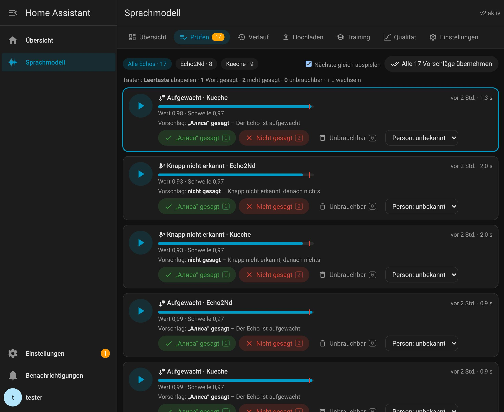
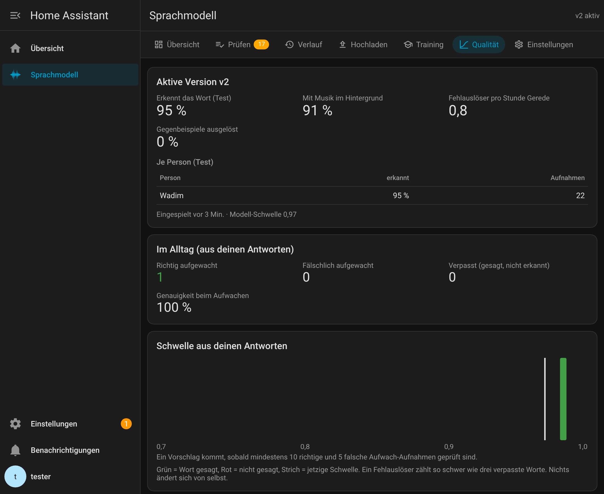
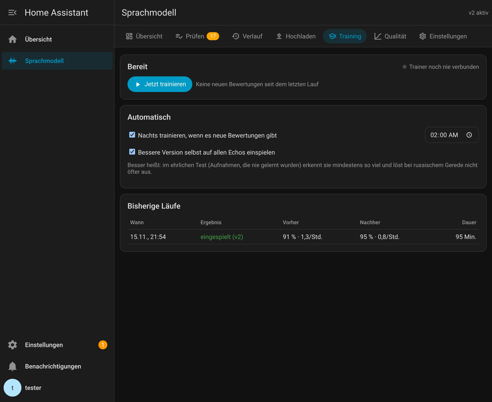
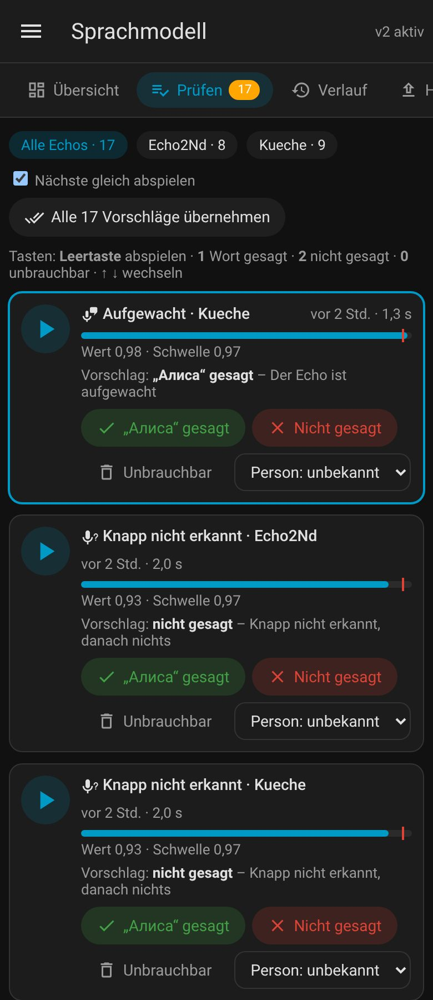

# Sprachmodell – eigenes Aktivierungswort für Home Assistant

Wie [VisionState](https://github.com/oleost/VisionState), nur für Sprache: Die Echos mit
[TECHO5](https://github.com/HuskerMinion/techo5) heben bei jedem Aufwachen ein paar Sekunden Ton auf.
Du hörst sie in der Seitenleiste nach, sagst mit einem Tipp, ob das Wort gesagt wurde, und ein
Trainer im Heimnetz macht daraus nachts eine bessere Version. Ist sie im ehrlichen Test besser,
landet sie von selbst auf allen Echos. Ohne Cloud, ohne KI, ohne Handgriffe.

## Was es kann

| Reiter | Wozu |
|---|---|
| **Übersicht** | Wie viele Aufnahmen warten, aktive Version, Training, gefundene Echos |
| **Prüfen** | Aufnahmen anhören (▶ oder Leertaste) und bewerten: **1** Wort gesagt, **2** nicht gesagt, **0** unbrauchbar. Jede Aufnahme hat einen Vorschlag (z. B. „Kurz danach hat es geklappt – vermutlich verpasst“); **Alle Vorschläge übernehmen** geht auch. Person wählen, damit man später sieht, wen das Modell gut versteht. |
| **Verlauf** | Alles Bewertete, Hochgeladene und der Testsatz – falsch getippt? Hier neu bewerten. |
| **Hochladen** | Zip-Dateien von der Setup-Seite eines Echos (Ordner `word` = Wort, `not_word` = Gegenbeispiele) hineinziehen. Doppelte werden erkannt. |
| **Training** | Fortschritt live (Schritt, Prozent, Restzeit), Knopf **Jetzt trainieren**, nachts automatisch, Verlauf aller Läufe mit vorher/nachher. |
| **Qualität** | Trefferquote im Test (gesamt, mit Musik, je Person), Fehlauslöser pro Stunde, Alltag aus deinen Antworten, **Schwelle aus deinen Antworten** mit Vorschlag und Knopf „An allen Echos übernehmen“, alle Versionen mit **Einspielen** (auch zurück). |
| **Einstellungen** | Gefundene Echos, Modell-Datei, Schwellen, Verbindung zum Trainer |

 

### Ehrlich testen
Jede fünfte bewertete Aufnahme kommt in den **Testsatz** und wird nie gelernt. Eine neue Version
gilt nur dann als besser, wenn sie auf genau diesen Aufnahmen mindestens so viel erkennt und bei
russischem Gerede nicht öfter auslöst als die aktive.

### Einspielen ohne Neustart
Die Integration schreibt das Modell nach `/config/custom_wake_words/<modell>.tflite`, leert den
Zwischenspeicher der ESPHome-Integration und verbindet die Echos kurz neu. Die Echos holen das Modell
mit der neuen Prüfsumme selbst. Alte Versionen bleiben in `/share/sprachmodell/modelle/` und lassen
sich unter **Qualität → Versionen** wieder einspielen.

## Entitäten

| Entität | Bedeutung |
|---|---|
| `sensor.sprachmodell_pruefliste` | Aufnahmen, die auf Prüfung warten (Attribute `je_echo`, `oldest_waiting_since`) |
| `sensor.sprachmodell_training` | bereit, wartet, daten, merkmale, training, test, fertig, fehler (Attribute `prozent`, `schritt`, `restzeit_min`) |
| `sensor.sprachmodell_version` | aktive Version |
| `sensor.sprachmodell_trefferquote` | erkannt im Test, % |
| `sensor.sprachmodell_fehlausloeser` | Fehlauslöser pro Stunde Gerede |
| `button.sprachmodell_training_starten` | Training anstoßen |
| `button.sprachmodell_jetzt_holen` | sofort bei den Echos nachsehen |
| `switch.sprachmodell_nachts_trainieren` | nachts trainieren, wenn es neue Bewertungen gibt |
| `switch.sprachmodell_automatisch_einspielen` | bessere Version selbst einspielen |
| `update.sprachmodell_integration` | neue Dateien der Integration einspielen |

Warten Aufnahmen länger als 7 Tage (einstellbar), erscheint ein Hinweis in der Glocke mit Link
zum Prüfen.

## Einrichten

1. Ordner `custom_components/sprachmodell` nach `/config/custom_components/` kopieren, HA neu starten.
2. Einstellungen → Geräte & Dienste → Integration hinzufügen → **Sprachmodell**. Die Standardwerte passen.
3. An jedem Echo (TECHO5) den Schalter **Keep wake clips** einschalten.
4. In der Seitenleiste erscheint **Sprachmodell**.

Weitere Einstellungen (Personen, Erinnerung, wie lange unbewertete Aufnahmen bleiben, nur Wort 1):
Integration → **Konfigurieren**.

## Trainer

Der Trainer ist ein eigener Dienst (Ordner `trainer/`), der in einem Container im Heimnetz läuft
(z. B. Proxmox LXC, Debian 12, ab 4 Kerne / 8 GB RAM, 80 GB Platte). Er meldet sich bei der
Integration mit Adresse und Schlüssel (Reiter **Einstellungen**), holt die bewerteten Aufnahmen,
trainiert ein [microWakeWord](https://github.com/OHF-Voice/micro-wake-word)-Modell, testet es und
schickt es zurück. Anleitung: [trainer/README.md](trainer/README.md).

### Schnittstelle (für eigene Trainer)
Kopfzeile `X-Sprachmodell-Schluessel: <Schlüssel>`:

| Aufruf | Zweck |
|---|---|
| `GET /api/sprachmodell/trainer/auftrag` | liegt ein Auftrag an? (`auftrag`, `abbrechen`, `aktiv`) |
| `GET /api/sprachmodell/trainer/liste` | alle bewerteten Aufnahmen mit `urteil`, `person`, `test` |
| `GET /api/sprachmodell/trainer/audio/<id>` | WAV 16 kHz mono |
| `GET /api/sprachmodell/trainer/modell` | aktive Version (tflite) |
| `POST /api/sprachmodell/trainer/status` | `{phase, prozent, schritt, restzeit_min, info}` |
| `POST /api/sprachmodell/trainer/ergebnis` | multipart `modell` (tflite) + `bericht` (JSON: `besser`, `cutoff`, `neu`, `alt`, `dauer_min`) |

## Lizenz
MIT
