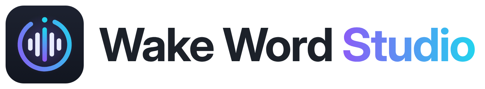
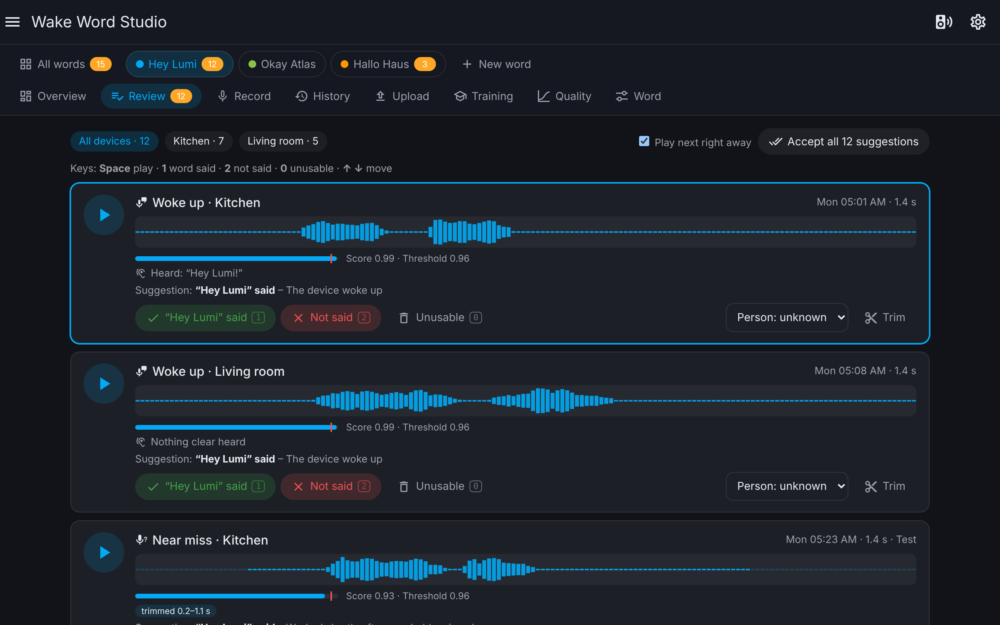
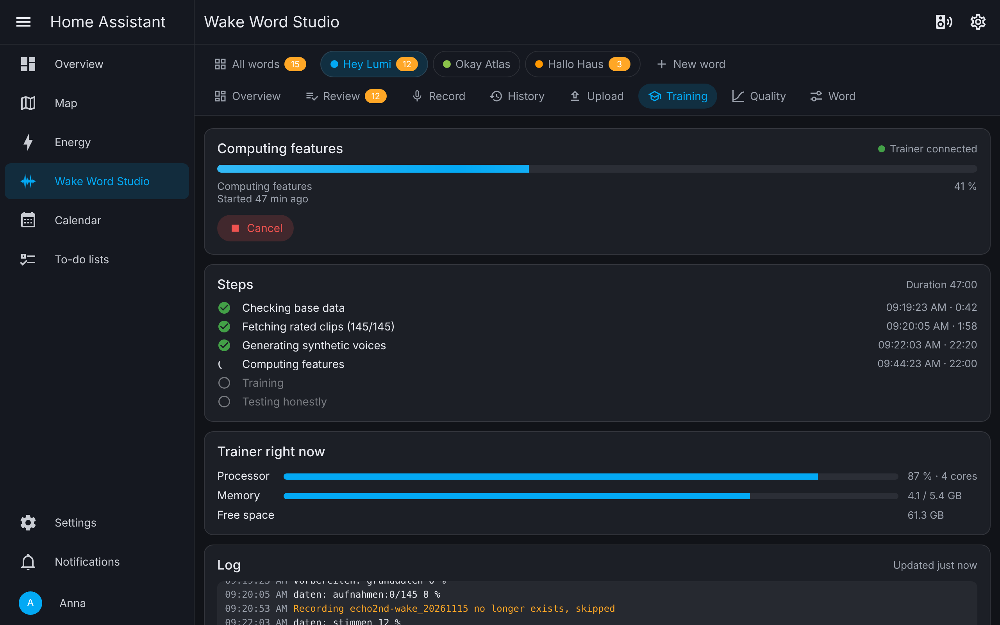
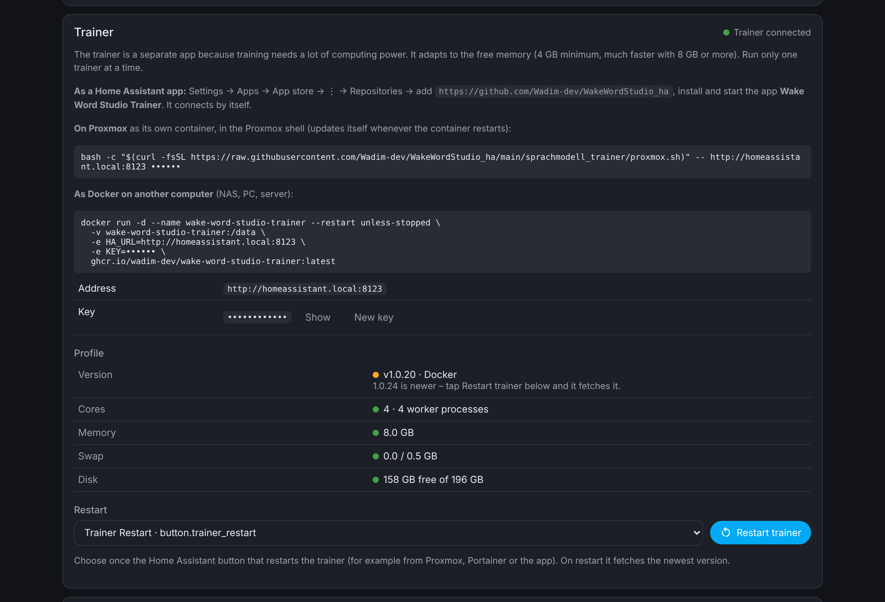

<p align="center">
  <picture>
    <source media="(prefers-color-scheme: dark)" srcset="https://raw.githubusercontent.com/Wadim-dev/WakeWordStudio_ha/main/docs/dark_logo.png">
    
  </picture>
</p>

<h3 align="center">Your own wake word, trained at home.</h3>

<p align="center">
  Review what your voice devices heard, train a better model and roll it out – all inside Home Assistant.<br>
  Works with <b>ESPHome voice devices</b> (micro wake word) · any word, any language · no YAML, no code.
</p>

<p align="center">
  <a href="https://my.home-assistant.io/redirect/hacs_repository/?owner=Wadim-dev&repository=WakeWordStudio_ha&category=integration"></a>
</p>

<p align="center">
  <a href="https://github.com/Wadim-dev/WakeWordStudio_ha/releases"></a>
  <a href="https://github.com/Wadim-dev/WakeWordStudio_ha/actions/workflows/validate.yml"></a>
  <a href="custom_components/sprachmodell/quality_scale.yaml"></a>
  
  
  <a href="LICENSE"></a>
</p>

<p align="center">
  
</p>

> **Hobby project.** Wake Word Studio is free and not affiliated with Nabu Casa, ESPHome or the microWakeWord project.
> Training uses the open-source [microWakeWord](https://github.com/kahrendt/microWakeWord) tools.

---

## Why Wake Word Studio?

<table>
  <tr>
    <td width="33%" valign="top"><h3>🎙️ Any word, any language</h3>"Hey Lumi", "Computer", "Алиса", "Hallo Haus" – create as many wake words as you like, in 13 languages, and decide per device which word sits on which slot.</td>
    <td width="33%" valign="top"><h3>✅ Gets better every night</h3>Your devices keep a few seconds of audio on every wake-up and near miss. You confirm with one tap, the trainer learns from your home – your voices, your rooms, your TV.</td>
    <td width="33%" valign="top"><h3>🏠 Stays at home</h3>No cloud, no account. Recordings stay in your Home Assistant; the trainer runs on your own hardware (Home Assistant app, Docker or Proxmox).</td>
  </tr>
</table>

## Get started in 3 steps

1. **Install** – tap the *Marketplace* button above, install **Wake Word Studio** and restart Home Assistant.
2. **Add the integration** – *Settings → Devices & services → Add integration → Wake Word Studio*. Confirm the storage folder (default `/share/sprachmodell`, part of your backups).
3. **Open Wake Word Studio** in the sidebar, create your word, choose the devices – done. Start a trainer from *Settings → Trainer* (one click as app, or one line for Docker/Proxmox).

---

## Supported devices

Every **ESPHome voice device** with a *Wake word* select is found by itself, whatever it is called in your home (renamed devices keep your name):
Home Assistant Voice PE, ESP32-S3-Box, M5Stack Atom Echo with micro wake word, and your own ESPHome satellites.

| Device firmware | Model rollout | Collect wake clips automatically |
|---|---|---|
| Any ESPHome voice firmware with micro wake word | ✅ | – (record in the browser or upload zips) |
| Firmware with wake clips (e.g. TECHO, switch *Keep wake clips*) | ✅ | ✅ every wake-up and near miss |

## Review

<p align="center"></p>

Every wake-up, every "woke up, then cancelled" and every near miss shows up here with the device, the score and a **suggestion**.
Listen, then tap *said* or *not said* – or use the keyboard (**Space** play · **1** said · **2** not said · **0** unusable). Accept all suggestions at once if you trust them.

## Record and upload

<p align="center"></p>

Say the word into your phone or PC – every take is cut by itself. Record negative examples (similar words, normal sentences) too. Zip files with `word/` and `not_word/` folders and loose WAV files are accepted as well.

## Train and test honestly

<p align="center"></p>

At night (or on a tap) the trainer fetches the reviewed recordings, adds thousands of synthetic voices of your word's language, trains a new version and tests it against recordings it **never learned** (every fifth one is held back).
Only a version that is better than the current one is rolled out. Home Assistant reads new wake word models when it starts, so a repair message offers the restart with one tap; afterwards the word is selected on all its devices by itself.

While it runs, the *Training* page shows every step with its start time and duration, the time left and the expected finish time, the trainer's processor, memory and disk load, and a live log, newest line first (also kept after an error, so you can see what went wrong). If the trainer is held up for a long time because it waits for memory or disk, Home Assistant shows a repair message with what to do.

## Quality

<p align="center"></p>

Recall in quiet and with music, false wakes per hour of speech, results per person, how the devices did in daily use – and a **threshold suggestion from your own answers** that you can apply to all devices with one tap. Every version stays available and can be rolled back.

## Words and devices

<p align="center"></p>

The start page tells you at a glance what matters now – a training with its progress and finish time, recordings waiting for you, a missing trainer, or that all is set – with one button to the next step. Each word shows its recall, open reviews, active version and the recordings of the last 14 days; below are the trainer with its live load, the queue and every device with its words.
<p align="center"></p>

## The trainer

Training needs a lot of computing power, so it runs in its own container. It adapts to its machine (cores, memory limit and free memory decide how many workers run: less memory = slower, but it finishes). 4 GB free memory minimum, 8 GB or more is much faster; the first run downloads about 8 GB of base data once. A watchdog makes sure it never hangs: a step that stops computing or runs short of memory is stopped and run again with fewer processes or smaller batches. Interrupted downloads continue, a run lost by a trainer restart is queued again with less memory, and a finished model waits on the trainer if Home Assistant is away.

<p align="center"></p>

*Settings → Trainer* shows a profile of the connected trainer – version, cores, memory, swap and free disk – each rated green, yellow or red with a tip what to change.

- **Home Assistant app**: *Settings → Apps → App store → ⋮ → Repositories*, add `https://github.com/Wadim-dev/WakeWordStudio_ha`, install **Wake Word Studio Trainer** and start it. It connects by itself.
- **Proxmox VE** (own LXC container, updates itself on every restart) – in the Proxmox shell:
  ```bash
  bash -c "$(curl -fsSL https://raw.githubusercontent.com/Wadim-dev/WakeWordStudio_ha/main/sprachmodell_trainer/proxmox.sh)" -- http://homeassistant.local:8123 <key>
  ```
  The container is placed on a local disk of the Proxmox host (the one with most free space, never network storage such as a NAS – training reads its data all the time). `CT_STORAGE=<name>` chooses one. If an existing trainer container lives on network storage: stop it, then *Resources → Root Disk → Volume Action → Move Volume* to a local storage.
- **Docker** on any other computer:
  ```bash
  docker run -d --name wake-word-studio-trainer --restart unless-stopped \
    -v wake-word-studio-trainer:/data \
    -e HA_URL=http://homeassistant.local:8123 \
    -e KEY=<key> \
    ghcr.io/wadim-dev/wake-word-studio-trainer:latest
  ```

The key is shown to administrators under *Wake Word Studio → Settings → Trainer*. Only one trainer should run at a time.

---

## Configuration

| Where | What |
|---|---|
| Setup / *Reconfigure* | **Storage folder** for recordings, versions and settings. Changing it moves all data to the new folder (copied first, the old folder is deleted only when the copy is complete). A folder that already holds Wake Word Studio data is used as it is. |
| Panel → Settings | Training time at night, reminder after how many days, how long unreviewed recordings are kept, list of people. |
| Panel → word → Word | Word, language, name in the device selection, colour, devices and slot. |
| Panel → word → Training | Train at night, roll out a better version by itself. |

Creating words, assigning devices, rolling out, changing settings and deleting are for **administrators**. Everybody else can review, record and upload.

## Entities

| Entity | Meaning |
|---|---|
| `sensor.<hub>_review_queue` | Recordings of all words waiting for review (attribute: per word) |
| `sensor.<hub>_trainer` | `disconnected`, `ready`, `training` (diagnostic) |
| `button.<hub>_fetch_recordings_now` | Ask the devices right away |
| `sensor.<word>_review_queue` | Waiting recordings of this word (per device, oldest) |
| `sensor.<word>_training` | `ready`, `waiting`, `preparing`, `fetching_data`, `features`, `training`, `testing`, `done`, `error` with progress and minutes left |
| `sensor.<word>_recall`, `sensor.<word>_false_wakes` | Result of the honest test of the active version |
| `sensor.<word>_active_version` | Active model version (diagnostic, disabled by default) |
| `button.<word>_start_training` | Queue a training run |
| `switch.<word>_train_at_night`, `switch.<word>_roll_out_better_version` | Automatic behaviour (configuration) |

Each word is its own device; it is created and removed together with the word.

### Example: remind me on my phone

```yaml
triggers:
  - trigger: numeric_state
    entity_id: sensor.wake_word_studio_review_queue
    above: 20
actions:
  - action: notify.mobile_app_my_phone
    data:
      message: "{{ states('sensor.wake_word_studio_review_queue') }} wake word recordings are waiting."
      data:
        url: /wake-word-studio/pruefen
```

## How data is updated

No entity polls. Devices with wake clips are asked every two minutes and right away when their *Wake clips* counter changes; already known clips are never fetched again and nothing is changed on the device. The trainer asks Home Assistant every 20 seconds for a job and reports progress while it works.

## Use cases

- A wake word nobody else has – the name of your house, your assistant or a word in your language.
- Fewer false wakes from the TV: review the mistakes for a week, let it train at night, done.
- Family members with different voices: record each person, see the recall per person.

## Known limitations

- Training needs a 64-bit machine (amd64 or aarch64); a Raspberry Pi 4 works but is slow.
- Automatic collection needs firmware that keeps wake clips; other devices still receive the models.
- Two wake word slots per device at most (as ESPHome offers).

## Troubleshooting

| Problem | Solution |
|---|---|
| Device missing | It needs a *Wake word* select in ESPHome. Devices without wake clips are listed too, with a note. |
| *Device not found* repair | The device was renamed, replaced or is offline. Choose it again under the word → Word → Devices and slot. |
| *No trainer connected* repair | Start the trainer app or container; check the key under Settings → Trainer. |
| Training stopped with *trainer did not report back* | The trainer restarted (update, out of memory). It adapts to memory by itself; start the run again. |
| New version not on the device | Restart Home Assistant (repair message *New wake word version ready*); the word is then selected by itself. You can also use *Select on the devices* on the word page. |
| *Trainer is slowed down* repair | The trainer mostly waits for memory or disk. Give its container more memory or move its disk to a local SSD (see *Settings → Trainer → Profile*). |

Diagnostics (*Settings → Devices & services → Wake Word Studio → ⋮ → Download diagnostics*) never contain the trainer key or names of people.

## Removal

1. *Settings → Devices & services → Wake Word Studio → ⋮ → Delete*.
2. Remove the trainer (app, Docker container or Proxmox container).
3. Optional: delete the storage folder and the model files in `/config/custom_wake_words` if you no longer use them.
4. Uninstall Wake Word Studio in the Marketplace.

---

## Deutsch

**Wake Word Studio** macht aus Home Assistant eine Werkstatt für eigene Aktivierungswörter: beliebig viele Wörter in jeder Sprache, Geräte und Platz frei wählbar, Aufnahmen mit einem Tipp prüfen, im Browser aufnehmen oder Zips hochladen, nachts trainieren, ehrlich testen und nur bessere Versionen von selbst einspielen. Die ganze Oberfläche gibt es auf Deutsch.

1. Über den Marketplace installieren und Home Assistant neu starten.
2. *Einstellungen → Geräte & Dienste → Integration hinzufügen → Wake Word Studio*, Ablageordner bestätigen (später änderbar über *Neu konfigurieren*, die Daten ziehen mit um).
3. **Wake Word Studio** in der Seitenleiste öffnen, Wort anlegen, Geräte wählen, Trainer starten (App, Docker oder Proxmox – Befehle unter *Einstellungen → Trainer*).

Die Startseite zeigt oben, was gerade zählt (Training mit „fertig ca. HH:MM“, wartende Aufnahmen, Trainer fehlt, neue Version bereit), mit einem Knopf zum nächsten Schritt; darunter jedes Wort mit Erkennungsquote und den Aufnahmen der letzten 14 Tage, den Trainer mit Auslastung, die Warteschlange und die Geräte.

Die Seite *Training* zeigt während eines Laufs jeden Schritt mit Startzeit und Dauer, Restzeit und voraussichtliches Ende, die Auslastung des Trainers (Prozessor, Arbeitsspeicher, Platte) und ein Live-Protokoll (neueste Zeile oben), das auch nach einem Fehler stehen bleibt. Eine bessere Version liegt danach bereit; Home Assistant liest neue Modelle beim Start, deshalb bietet eine Reparaturmeldung den Neustart mit einem Tipp an, danach wird das Wort an den Geräten von selbst ausgewählt.

Gefunden wird jedes ESPHome-Sprachgerät mit der Auswahl „Aktivierungswort“, egal wie es heißt. Geräte mit Firmware, die Aufnahmen aufhebt (z. B. TECHO, Schalter *Keep wake clips*), liefern ihre Aufnahmen von selbst.

## License

MIT – see [LICENSE](LICENSE).
